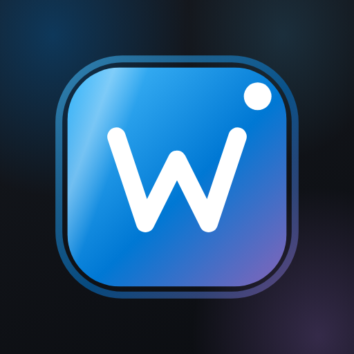

<div align="center">



# Wudysoft

**API, Tools & Developer Platform** — satu dasbor kaca (glassmorphism) untuk menguji API, berbagi kode, menyimpan teks, dan ngobrol realtime.


[Fitur](#-fitur) · [Mulai cepat](#-mulai-cepat) · [Konfigurasi](#-konfigurasi-tanpa-env) · [Struktur](#-struktur-proyek) · [Deploy](#-deploy) · [Kustomisasi](#-kustomisasi)

</div>

---

## ✨ Fitur

| | |
|---|---|
| 🔐 **Autentikasi lengkap** | Email + password, daftar akun, login tamu instan, serta OAuth **Google** & **GitHub** lewat NextAuth v4 (JWT). Password di-hash `bcrypt`, sesi disinkronkan dengan database. |
| 🧪 **API Playground** | Endpoint terdeteksi otomatis dari spesifikasi **OpenAPI** yang dibuat oleh `scripts/openapi-gen.mjs`. Jalankan request seperti Postman langsung di browser, lengkap dengan tab Params/Headers/Body/Auth, koleksi, dan generator kode. |
| 📡 **Live Stats** | Telemetri realtime: request, latensi, status, dan sistem. Memakai **Socket.IO**, otomatis turun ke *polling* di hosting tanpa WebSocket (mis. Netlify). |
| 💬 **Chat Rooms** | Ruang obrolan realtime dengan daftar grup, gelembung berefek pegas, dan layout khusus mobile. |
| 📋 **Pastes** | CRUD paste (judul, sintaks, kedaluwarsa) dengan pencarian di server dan pagination. |
| 🧩 **Code Share** | Bagikan potongan kode: tag bahasa, suka/tidak suka, hitungan lihat, urut & filter, pagination. |
| 🛠️ **Tools** | Code Beautifier dan Multi-Host Uploader. |
| 👤 **Profil** | Ringkasan akun, kelengkapan profil, foto, sesi & perangkat, plus kartu **GitHub** pengembang (repo, bintang, bahasa). |
| 🎨 **Theme Studio** | Puluhan preset + editor tema: warna, latar, partikel, blur, kecepatan animasi, transisi halaman. Ekspor/impor JSON. |
| 🎞️ **Animasi halus & bervariasi** | 11 gaya masuk, transisi halaman otomatis per rute, hitung naik, tombol magnetik, ripple, progres gulir. Semua menghormati `prefers-reduced-motion` dan pengaturan tema. |
| 🎵 **Audio** | BGM dari **link YouTube** (video/playlist), efek suara sintetis untuk welcome, login berhasil/gagal, logout, dan 404 — tanpa file audio. |
| 🧭 **UI modern** | Sidebar melengkung glass, bottom dock dengan menu cepat ⚡, tombol tema & audio menempel di tepi kanan, 404 interaktif, ikon besar di halaman login. |
| 🔎 **SEO & preview otomatis** | Meta lengkap, JSON-LD, `robots.txt` & `sitemap.xml` dinamis, dan gambar OG 1200×630 dibuat otomatis (`/api/og`) dari isi tiap halaman. |
| 📱 **PWA & responsif** | Dapat dipasang, manifest dengan *shortcuts*, diuji tanpa overflow dari 320px sampai 1440px. |
| 🪵 **Log API otomatis** | Semua `pages/api/**` dibungkus loader webpack: method, path, status, durasi, ukuran; data sensitif disamarkan. |
| 🛡️ **Middleware** | Rate limit `/api`, proteksi halaman, security header, dan pengalihan preview untuk bot media sosial. |

## 🚀 Mulai cepat

```bash
npm install
npm run dev         # pengembangan  → http://localhost:3000
npm run build       # build production (menjalankan openapi-gen lebih dulu)
npm run start       # production dengan server kustom + Socket.IO
```

> Tidak perlu file `.env`. Semua konfigurasi ada di `configs/*.cjs`.
> Jika `PORT` terpakai, server otomatis pindah ke port kosong berikutnya dan mencetak URL-nya.

**Prasyarat:** Node.js 18+ dan sebuah database MongoDB (URI diisi di `configs/apiConfig.cjs`).

## ⚙️ Konfigurasi (tanpa `.env`)

| File | Isi | Dipakai di |
|---|---|---|
| `configs/siteConfig.cjs` | Konfigurasi **publik**: nama, domain, target deploy, `GITHUB_USER`, `DEFAULT_BGM_URL`, obfuscator | Klien & server |
| `configs/apiConfig.cjs` | Konfigurasi **rahasia**: URI MongoDB, secret NextAuth, client ID/secret OAuth | Hanya server |

Isi penting:

- `DOMAIN_URL` / `SITE_URL` — domain situs (dipakai canonical, sitemap, OG).
- `DEPLOY_TARGET` — `"netlify"` (serverless) atau `"vps"` (Node biasa, output `standalone`).
- `GITHUB_USER` — akun yang ditampilkan pada kartu GitHub di profil.
- `DEFAULT_BGM_URL` — BGM bawaan (link YouTube); kosongkan bila tidak ingin musik otomatis.
- `OBFUSCATE_CLIENT` — obfuscate JS klien saat build (menambah ±11% ukuran).

**Callback OAuth:** `{URL}/api/auth/callback/github` dan `{URL}/api/auth/callback/google`.

## 🗂️ Struktur proyek

```
.
├─ pages/
│  ├─ index.js · playground.js · profile.js · 404.js
│  ├─ auth/            hub masuk/daftar, tamu, OAuth
│  ├─ rooms/           chat realtime
│  ├─ stats/           live stats
│  ├─ tools/           beautify · compiler · upload · pastes · code-share
│  ├─ robots.txt.js · sitemap.xml.js        (SSR)
│  └─ api/             auth, profile, rooms, code-share, github, og, preview,
│                      stats, tools/paste/v1, openapi, health, …
├─ components/
│  ├─ Layout.js · CurvedSidebar.js · ThemeFab.js · AudioControl.js
│  ├─ AuthHero.js · Pagination.js · GithubCard.js · Seo.js
│  ├─ CustomThemeStudio.js · PageTransition.js · WudysoftBrand.js
│  └─ motion/          Reveal, Stagger, CountUp, Magnetic, GlobalEffects
├─ lib/                auth, users, mongoose, apiLogger, liveData
├─ models/             User · ApiLog · Room · Paste · CodeShare
├─ src/
│  ├─ index.js         server kustom + auto port + log live
│  └─ lib/             audio, interactiveEffects (sound), themes, nav, rateLimit, …
├─ scripts/            openapi-gen, api-log-loader, trace-size, prepare-standalone
├─ styles/             globals.css · motion.css
├─ configs/            siteConfig · apiConfig
└─ public/             manifest.json · sw.js · icons · og.png
```

## 🌐 Deploy

### Netlify
1. Atur `DEPLOY_TARGET: "netlify"` di `configs/siteConfig.cjs` (bawaan).
2. Hubungkan repo, build command `npm run build`.
3. Jika muncul *"The function exceeds the maximum size of 250 MB"*, jalankan `npm run build && npm run size` untuk melihat paket terbesar. `next.config.js` sudah mengecualikan alat build lewat `experimental.outputFileTracingExcludes`.

Di Netlify tidak ada WebSocket, jadi Live Stats memakai *polling* (`/api/stats/live`) otomatis.

### VPS / server Node
```bash
# set DEPLOY_TARGET: "vps"
npm run build
npm run start:standalone     # menyalin aset statis lalu menjalankan .next/standalone/server.js
```

## 🎛️ Kustomisasi

- **Tema:** tombol ⚙️ di tepi kanan membuka Theme Studio. Pilihan tersimpan di browser.
- **Audio:** tombol 🎵 di bawahnya. Tempel link YouTube (video / playlist / youtu.be / Shorts) lalu **Setel**. BGM mulai setelah interaksi pertama (aturan autoplay browser). Tiap efek suara bisa dimatikan atau dites satu per satu.
- **Animasi:** semua bisa dimatikan dari Theme Studio atau otomatis mati saat perangkat meminta *reduced motion*.
- **Halaman baru:** tambahkan ke `pages/` dan daftarkan di `src/lib/siteMap.js` (sitemap) dan `components/CurvedSidebar.js` (menu).
- **Endpoint baru:** letakkan di `pages/api/**`; log dibuat otomatis oleh loader. Spesifikasi OpenAPI diperbarui oleh `npm run openapi`.

## 📈 Log realtime API

Semua request `/api/*` dicatat oleh `lib/apiLogger.cjs` (method, path, query, status, durasi, ukuran, pratinjau body; password/token/cookie disamarkan). Halaman `/stats` menerima aliran data hanya untuk pengguna yang login.

## 📝 Catatan

- Rate limit memakai memori proses (cocok untuk 1 instance). Untuk banyak instance, ganti dengan Redis.
- BGM memuat pemutar tersembunyi dari YouTube; video yang melarang embed akan menampilkan pesan error di panel Audio.
- Gambar OG dibuat di *edge runtime* (`/api/og`) dan di-*rewrite* otomatis untuk user-agent bot media sosial.

---

<div align="center">

Dibuat dengan ❤️ oleh **[AyGemuy](https://github.com/AyGemuy)**

</div>

## Compiler & Kode request

- `/tools/compiler`: JS/TS/Python/HTML jalan di browser (Web Worker, Pyodide, iframe sandbox); C, C++, Java, Go, Rust, PHP, Ruby, dll. lewat `pages/api/tools/run.js` (proxy ke Wandbox, tanpa akses internet).
- Modal **Kode** di Playground: 18 bahasa/klien dengan syntax highlighting (`src/lib/codegen.js`, `src/lib/highlight.js`).
- Endpoint di Playground digabung per path; metode dipilih di dropdown request.
