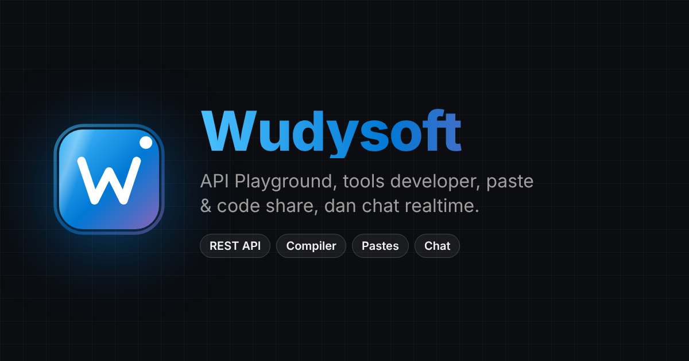

<div align="center">

<!-- Ganti URL/path gambar banner di bawah jika ingin memakai URL absolut -->


# ✨ Wudysoft

**Starter Next.js bergaya Glassmorphism — lengkap dengan Auth (OAuth + Guest), Playground, Middleware Anti-Limit, PWA, Realtime API Log, & Auto Link Preview.**


[🚀 Mulai Cepat](#-tutorial-instalasi--menjalankan) •
[🧩 Fitur & Status](#-status-fitur--modul) •
[🔐 Setup OAuth](#-tutorial-setup-oauth) •
[☁️ Deploy Netlify](#-panduan-deploy-ke-netlify) •
[🛠️ Halaman & API Baru](#-halaman--endpoint-baru)

</div>

---

## 📊 Status Fitur & Modul

| Modul / Fitur | Status | Keterangan Singkat |
| :--- | :---: | :--- |
| **Auth System (OAuth + Guest)** | 🟢 Aktif | Login GitHub, Google (NextAuth), & sesi tamu (`/api/auth/*`) |
| **Middleware Anti-Limit & Security** | 🟢 Aktif | Rate limit `/api/*`, proteksi `/playground`, & security header |
| **Auto Port Finder** | ⚡ Otomatis | Pindah ke port kosong berikutnya jika `PORT` sedang dipakai |
| **Realtime API Logger & `/stats`** | 🟢 Aktif | Stream via Socket.IO & auto-fallback ke polling di serverless |
| **Dynamic OG & Link Preview** | ⚡ Otomatis | Generate OG 1200×630 + meta otomatis untuk crawler sosmed |
| **OpenAPI Generator** | ⚡ Otomatis | Spesifikasi API dibuat otomatis sebelum `dev` & `build` |
| **PWA Support** | 🟢 Aktif | Tersedia `manifest.json`, `sw.js`, dan aset ikon lengkap |

> [!NOTE]
> **Tanpa `.env`!** Semua konfigurasi proyek (domain, database, OAuth, dan opsi build) dikelola terpusat secara hardcoded di `configs/apiConfig.cjs` dan `configs/siteConfig.cjs`.

---

## 🚀 Tutorial Instalasi & Menjalankan

Ikuti langkah-langkah berikut untuk menjalankan **Wudysoft** di komputer lokal Anda:

### Step 1 — Clone & Install Dependensi
```bash
git clone <url-repo-anda>
cd wudysoft
npm install
```

### Step 2 — Atur Konfigurasi (Opsional)
Buka file konfigurasi berikut sebelum menjalankan server jika ingin menyesuaikan domain, secret OAuth, atau fitur build:
- `configs/apiConfig.cjs` → Pengaturan API, DB, & `GITHUB_SECRET`
- `configs/siteConfig.cjs` → Pengaturan tampilan, domain, & opsi `OBFUSCATE_CLIENT`

### Step 3 — Build & Jalankan Server
Pilih mode sesuai kebutuhan Anda:

```bash
# 🛠️ Mode Development (otomatis generate OpenAPI sebelum jalan)
npm run dev

# 🚀 Mode Production (Custom Server + Auto Live Log)
npm run build
npm run start

# 📦 Mode Standalone (menyalin aset statis & jalankan server standalone)
npm run start:standalone
```

> [!TIP]
> **Auto Port Detection:** Jika `PORT` default sudah dipakai aplikasi lain, `src/index.js` akan otomatis mencari port kosong berikutnya dan menampilkan URL aktifnya di terminal.

---

## 📁 Struktur Proyek

<details>
<summary><b>📂 Klik untuk melihat peta direktori lengkap</b></summary>

<br>

```text
wudysoft/
├── configs/
│   ├── apiConfig.cjs         # Konfigurasi API, DB, & OAuth Secret
│   └── siteConfig.cjs        # Konfigurasi situs & obfuscator client
├── scripts/
│   └── openapi-gen.mjs       # Generator spesifikasi OpenAPI otomatis
├── src/
│   ├── index.js              # Custom server + auto port + live API log
│   └── lib/                  # Session, rateLimit, oauth, seoMap, linkPreview
├── middleware.js             # Rate limit /api, proteksi /playground, security header
├── pages/
│   ├── api/
│   │   ├── auth/*            # guest, me, logout
│   │   ├── oauth/*           # redirect + callback (github, google)
│   │   ├── playground/*      # echo
│   │   ├── tools/paste/v1.js # API CRUD Paste
│   │   ├── code-share.js     # API Code Share
│   │   └── og.js             # Edge OG Image Generator (1200×630)
│   ├── auth/*                # hub, oauth, guest
│   ├── tools/                # pastes, code-share
│   ├── stats.js              # Dashboard log API realtime
│   ├── rooms.js              # Daftar channel (horizontal strip di mobile)
│   └── playground.js         # API Playground interaktif
├── components/               # Seo, Background, Navbar, ThemePanel, Layout
└── public/                   # manifest.json, sw.js, icons, og.png
```

</details>

---

## 🔐 Tutorial Setup OAuth

Untuk mengaktifkan login menggunakan **GitHub** dan **Google** via NextAuth:

1. **Siapkan Callback URL** di dashboard OAuth Provider Anda:

| Provider | Callback URL | File Konfigurasi |
| :--- | :--- | :--- |
| **GitHub** | `{URL}/api/auth/callback/github` | Isi `GITHUB_SECRET` di `configs/apiConfig.cjs` |
| **Google** | `{URL}/api/auth/callback/google` | Atur credential di `configs/apiConfig.cjs` |

2. **Host Detection Otomatis:** NextAuth membaca host langsung dari request (`AUTH_TRUST_HOST` sudah diatur di `lib/auth.js`), sehingga Anda tidak perlu mengatur `NEXTAUTH_URL` di `.env`.

> [!WARNING]
> **Catatan Rate Limit:** Rate limiter bawaan menggunakan memori proses (cocok untuk 1 instance). Jika Anda melakukan scale ke banyak instance/server, ganti penyimpanan rate limit ke **Redis**.

---

## 🛠️ Halaman & Endpoint Baru

Berikut adalah halaman tools dan endpoint terbaru yang siap digunakan:

| Halaman / Fitur | Endpoint Terkait | Tautan Bagikan | Keterangan |
| :--- | :--- | :--- | :--- |
| **Pastes CRUD** (`/tools/pastes`) | `pages/api/tools/paste/v1.js` | `/paste/[key]` | Mendukung action: `create \| get \| update \| delete \| list` |
| **Code Share** (`/tools/code-share`) | `pages/api/code-share.js` | `/code/[id]` | Berbagi snippet kode dengan preview meta otomatis |
| **Rooms** (`/rooms`) | — | `/rooms` | Daftar channel tampil sebagai **strip horizontal** di mobile |

---

## 📡 Realtime Log API & Statistik (`/stats`)

<details>
<summary><b>📊 Klik untuk melihat cara kerja Logging & Streaming Realtime</b></summary>

<br>

1. **Pencatatan Otomatis (`lib/apiLogger.cjs`)**
   - Setiap request ke `/api/*` dicatat lengkap: `method`, `path`, `query`, `status`, `durasi`, `ukuran`, serta pratinjau body request & respons.
   - Data sensitif seperti `password`, `token`, dan `cookie` otomatis **disamarkan**.

2. **Streaming & Auto-Fallback**
   - Halaman `/stats` menerima stream realtime melalui **Socket.IO** (`/api/live` → `/api/live-socket`).
   - Pada hosting tanpa dukungan WebSocket (seperti **Netlify**), sistem otomatis turun ke mode **polling** (`/api/stats/live`).
   - Akses stream log hanya tersedia untuk **pengguna yang sudah login**.

3. **Cakupan Rekaman**
   - Menggunakan custom server (`npm start`): **semua route** direkam otomatis.
   - Tanpa custom server (serverless): route yang dibungkus wrapper `withApiLog` yang akan terekam.

</details>

---

## 🔗 Pratinjau Link Otomatis (SEO & Dynamic OG)

<details>
<summary><b>🖼️ Klik untuk melihat mekanisme Meta Tag & Crawler Link Preview</b></summary>

<br>

- **Global SEO Otomatis:** `components/Seo.js` menghasilkan tag `title`, `description`, `canonical`, Open Graph, Twitter Card, hingga `JSON-LD`. Default per rute diatur di `src/lib/seoMap.js` dan dipasang di `_app.js` agar tidak ada halaman tanpa meta.
- **Generator Gambar OG:** Endpoint `/api/og?title=&desc=&tag=` berjalan di Edge (`next/og`) untuk membuat gambar **1200×630** secara dinamis.
- **SSR Halaman Dinamis:** Halaman `/paste/[key]` dan `/code/[id]` di-render di server dengan meta yang diambil langsung dari isi konten.
- **Smart Crawler API Preview (`lib/linkPreview.cjs`):**
  - Jika endpoint `/api/*` (yang dibungkus `withApiLog`) diakses oleh bot/crawler (**WhatsApp, Telegram, Discord, X, Facebook, Slack**, dll), respons JSON/teks otomatis diubah menjadi halaman HTML ber-meta OG dari isi respons.
  - Klien/aplikasi API biasa tetap menerima **JSON asli**.
  - **Uji Manual di Browser:** Tambahkan parameter `?__preview=1` pada URL endpoint API Anda, contoh:
    ```text
    https://domain-anda.com/api/playground/echo?msg=halo&__preview=1
    ```

</details>

---

## ☁️ Panduan Deploy ke Netlify

<details>
<summary><b>🚀 Klik untuk melihat panduan deploy, optimasi ukuran, & troubleshooting</b></summary>

<br>

### 1. Konfigurasi Tanpa Environment Variable
- Tidak ada `.env` yang perlu diisi di dashboard Netlify.
- Cukup ubah domain, DB, dan credential OAuth di `configs/*.cjs`.
- Mode `output: "standalone"` dimatikan otomatis saat build di lingkungan Netlify.

### 2. Mengatasi Error Ukuran Serverless (`> 250 MB`)
Jika muncul error `The function exceeds the maximum size of 250 MB`:
1. Jalankan perintah audit ukuran paket terbesar:
   ```bash
   npm run build && npm run size
   ```
2. `next.config.js` sudah mengecualikan alat build berat (`SWC`, `esbuild`, `typescript`, `eslint`, `sharp`, dll.) melalui `experimental.outputFileTracingExcludes`.

### 3. Optimasi Ukuran JS Klien (Build)
- Secara default obfuscator menambah sekitar **±11%** ukuran JS klien.
- Untuk mematikannya demi ukuran bundle yang lebih ringan, ubah di `configs/siteConfig.cjs`:
  ```js
  OBFUSCATE_CLIENT: false
  ```

</details>

---

<div align="center">
  <sub>Dibuat dengan ❤️ menggunakan <b>Wudysoft Starter</b> — Next.js Glassmorphism</sub>
</div>